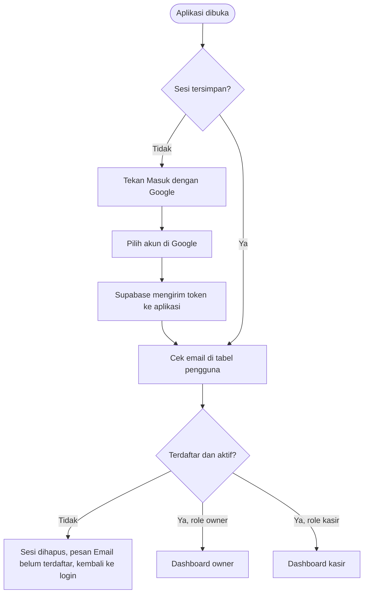

# Laporan Pengembangan — Pemrograman Mobile I
## Login OAuth Google & Manajemen Kasir
### Studi Kasus: Sistem Informasi Penjualan dan Pengelolaan Stok UMKM Sticky Milk

> **Status draf:** bagian 5 (Implementasi) ditulis mengikuti rencana pembagian tugas. Sesuaikan dengan kode yang akhirnya dikerjakan. Bagian 6 (Bukti) dan 8 (Kesimpulan) sengaja dikosongkan dan diisi setelah pengujian selesai. Hapus catatan ini sebelum dikumpulkan.

---

### Identitas Proyek & Praktikum

- **Mata Kuliah:** Pemrograman Mobile I
- **Pertemuan:** [isi nomor pertemuan]
- **Dosen Pengampu:** Mohamad Firdaus, M.Kom
- **Tanggal Praktikum:** November 2026
- **Kelas / Kelompok:** Kelas B / Kelompok 6
- **Pembagian Tugas Anggota Kelompok (urutan pengerjaan):**
  1. **Dani Hidayat:** Setup Google Cloud & Supabase — provider Google OAuth, tabel `pengguna`, Row Level Security, dan pengujian RLS.
  2. **Dimas Faturohman:** Login OAuth di aplikasi — klien Supabase dengan sesi tersimpan, `AuthContext`, layar login, dan penjaga rute berdasarkan role.
  3. **Alfiah Lutfi Sabilah:** Manajemen Kasir (owner) — mendaftarkan akun **kasir maupun owner**, menonaktifkan, dan menghapus email, serta tab baru di bottom navigator owner.
  4. **Istafty Keva Yuftika:** Profil & sapaan dari data akun asli, pengujian seluruh skenario, dan dokumentasi laporan.

---

## Video Flow Login OAuth & Manajemen Kasir
Drive : [isi tautan]

Youtube : [isi tautan]

---

## 1. Tujuan dan Capaian

Login aplikasi Sticky Milk sebelumnya memakai data akun tiruan (`DUMMY_USERS`) di `src/app/login.tsx`: tidak ada sesi, tidak ada penjagaan rute, dan nama akun di halaman profil maupun sapaan dashboard ditulis langsung di kode. Pengembangan ini bertujuan:

1. Mengganti login tiruan dengan **Google OAuth** melalui **Supabase Auth**.
2. Membatasi akses: hanya email yang **didaftarkan owner** pada fitur Manajemen Kasir yang dapat masuk.
3. Menambahkan fitur **Manajemen Kasir** pada menu owner, sebagai tab baru di bottom navigator.
4. Menjaga rute sesuai role: grup `(owner)` hanya untuk owner dan grup `(kasir)` hanya untuk kasir.
5. Menyimpan sesi sehingga pengguna tetap masuk setelah aplikasi ditutup dan dibuka kembali.
6. Menampilkan nama, email, dan role dari akun yang sedang masuk pada halaman profil dan sapaan dashboard.

---

## 2. Skenario dan Alur Login

### 2.1 Skenario Penggunaan

1. Owner membuka tab **Kasir**, lalu mendaftarkan email dan memilih peran (**Kasir** atau **Owner**).
2. Kasir menekan **Masuk dengan Google** dan memilih akun Google dengan email yang sama.
3. Aplikasi mencari email itu di tabel `pengguna`. Jika tidak ada atau berstatus nonaktif, sesi dihapus dan muncul pesan "Email belum terdaftar".
4. Jika ada, role menentukan tujuan: `owner` ke `/(owner)/dashboard`, `kasir` ke `/(kasir)/dashboard`.

### 2.2 Diagram Alur



### 2.3 Langkah Rinci

**A. Owner mendaftarkan kasir atau owner baru**

1. Owner masuk, membuka tab Kasir, lalu menekan tombol tambah.
2. Owner mengisi email (dan nama bila perlu) dan memilih peran: **Kasir** (bawaan) atau **Owner**. Aplikasi merapikan email (`trim`, huruf kecil), memeriksa format, dan memeriksa apakah email sudah ada di daftar.
3. `tambahKasir` menyimpan baris baru ke `pengguna` dengan `role` sesuai pilihan (`'kasir'` atau `'owner'`) dan `aktif = true`. RLS mengizinkannya karena `is_owner()` bernilai benar. Jika email sudah ada, database menolak (kolom `unique`) dan aplikasi menampilkan "Email sudah terdaftar".
4. Kasir langsung muncul di daftar. Owner dapat menonaktifkan (`aktif = false`) atau menghapus barisnya kapan saja. Database menolak bila yang dinonaktifkan, dihapus, atau diturunkan perannya adalah **owner aktif terakhir**, supaya tidak ada kondisi tanpa owner.

**B. Login (owner maupun kasir)**

1. Splash selesai. `useAuth()` memeriksa sesi yang tersimpan di AsyncStorage. Jika ada, lanjut ke langkah 6; jika tidak, layar login ditampilkan.
2. Pengguna menekan **Masuk dengan Google**. Aplikasi meminta URL otorisasi ke Supabase dengan `redirectTo` berisi `Linking.createURL('auth/callback')`.
3. `WebBrowser.openAuthSessionAsync` membuka halaman Google. Pengguna memilih akun dan menyetujui.
4. Google mengarahkan ke callback Supabase (`https://fsmatvpxqtlmwwovvhkk.supabase.co/auth/v1/callback`). Supabase membuat atau menemukan pengguna di Authentication, lalu mengarahkan ke `redirectTo` dengan `access_token` dan `refresh_token` pada bagian `#` URL.
5. Jendela tertutup dan aplikasi menerima URL itu. Token dibaca dari URL dan dipasang dengan `supabase.auth.setSession`. Jika URL membawa error, atau pengguna menutup jendela di tengah jalan, aplikasi kembali ke layar login tanpa menampilkan error teknis.
6. Aplikasi mengambil email dari sesi lalu mencarinya di `pengguna` dengan `aktif = true`. RLS "baca baris sendiri" hanya mengembalikan baris milik email itu.
7. Jika tidak ada baris: `supabase.auth.signOut()`, lalu layar login menampilkan "Email belum terdaftar. Hubungi owner." Jika ada: `profil` diisi (email, nama, role, foto).
8. Penjaga rute membuka grup sesuai `profil.role`.

**C. Keluar dan akun yang dinonaktifkan**

- Keluar memanggil `signOut()`. `profil` menjadi `null` dan penjaga rute mengembalikan pengguna ke layar login.
- Kasir yang dinonaktifkan atau dihapus tidak langsung terputus, karena sesinya di Supabase tidak ikut dicabut. Pemutusannya terjadi di aplikasi: pengecekan `pengguna` pada langkah B6 diulang setiap aplikasi dibuka, dan bila gagal sesi dihapus.

---

## 3. Arsitektur Basis Data & Keamanan (Supabase)

### 3.1 Skema Tabel `pengguna` (Modul Setup — Dani)

Tabel ini adalah daftar email yang boleh masuk. Baris owner pertama dimasukkan manual lewat SQL Editor dengan email owner yang sebenarnya.

```sql
create table pengguna (
  id uuid primary key default gen_random_uuid(),
  email text not null unique check (email = lower(btrim(email))),
  nama text,
  role text not null check (role in ('owner', 'kasir')),
  aktif boolean not null default true,
  created_at timestamptz not null default now()
);
```

### 3.2 Row Level Security Tabel `pengguna`

```sql
alter table pengguna enable row level security;

create or replace function is_owner() returns boolean
language sql stable security definer set search_path = public as $$
  select exists (
    select 1 from pengguna
    where email = lower(auth.jwt() ->> 'email') and role = 'owner' and aktif
  );
$$;

create policy "baca baris sendiri" on pengguna for select to authenticated
  using (email = lower(auth.jwt() ->> 'email'));

create policy "owner kelola semua" on pengguna for all to authenticated
  using (is_owner()) with check (is_owner());
```

Fungsi `is_owner()` dibuat `security definer` supaya policy tidak memanggil dirinya sendiri secara berulang. Semua perintah SQL di atas disimpan di `supabase/auth-kasir.sql`.

**Pengaman owner terakhir.** Karena owner dapat menambah owner lain, ada trigger `pengguna_lindungi_owner_terakhir` (`supabase/owner-terakhir.sql`) yang menolak penghapusan, penonaktifan, atau penurunan peran owner aktif terakhir dengan pesan "Tidak boleh: ini satu-satunya owner aktif. Tambahkan owner lain dulu." Owner yang bukan terakhir tetap bisa dihapus atau dinonaktifkan seperti biasa.

---

## 4. Setup Google OAuth & Supabase (*Dani Hidayat*)

Setup dilakukan satu kali. Hasilnya satu **Web Client ID** beserta secret yang dipasang di Supabase; aplikasi tidak menyimpan kunci Google apa pun. Cara ini memakai alur browser (`signInWithOAuth`), sehingga cukup client bertipe Web dan berjalan di Expo Go maupun dev build.

### 4.1 Google Cloud Console

1. Buat project baru, misalnya "sticky-milk".
2. Buka **Google Auth Platform**. Isi nama aplikasi "Sticky Milk", email dukungan, Audience **External**, dan email kontak.
3. Menu **Data Access**: pastikan scope `openid`, `.../auth/userinfo.email`, dan `.../auth/userinfo.profile` terdaftar. Tidak ada scope lain, karena scope sensitif dan terbatas memerlukan verifikasi yang lama.
4. Menu **Audience**: status awal Testing. Menurut halaman bantuan Google, aplikasi yang hanya meminta nama, email, dan profil tidak membutuhkan Test user dan tidak menampilkan peringatan. Jika Google tetap menolak dengan `access_denied`, tambahkan akun sebagai Test user (batas 100) atau tekan **Publish app**.
5. Menu **Clients** → Create client → tipe **Web application**, nama "Sticky Milk Supabase". Pada Authorized redirect URIs isi `https://fsmatvpxqtlmwwovvhkk.supabase.co/auth/v1/callback`.
6. Salin **Client ID** dan **Client secret**. Client secret disimpan di tempat aman dan **tidak dimasukkan ke repo**.

### 4.2 Supabase Dashboard

1. Authentication → Providers → **Google**: aktifkan, tempel Client ID dan Client secret, lalu simpan. Opsi "Skip nonce check" dibiarkan mati.
2. Authentication → **URL Configuration**:
   - Redirect URLs: `kelompok6://**` (dev build dan APK; scheme `kelompok6` dari `app.json`).
   - Redirect URLs: `exp://**` (Expo Go selama pengembangan; dihapus sebelum demo akhir bila sudah memakai dev build).
   - Site URL: `kelompok6://auth/callback` (pengganti nilai bawaan `http://localhost:3000`).
3. SQL Editor: jalankan `supabase/auth-kasir.sql` (tabel `pengguna`, baris owner pertama, RLS).

### 4.3 Uji Tanpa Aplikasi

Buka `https://fsmatvpxqtlmwwovvhkk.supabase.co/auth/v1/authorize?provider=google` di browser, pilih akun Google, lalu buka Authentication → Users. Akun itu harus muncul di sana. Halaman terakhir di browser boleh menampilkan error karena aplikasi belum terlibat.

### 4.4 Masalah yang Mungkin Muncul

| Gejala | Penyebab | Perbaikan |
|---|---|---|
| `redirect_uri_mismatch` dari Google | Redirect URI di Google tidak sama persis dengan callback Supabase | Salin ulang dari halaman provider Google di Supabase, tanpa spasi atau garis miring di akhir |
| `Unsupported provider: provider is not enabled` | Provider Google belum diaktifkan | Aktifkan di Authentication → Providers |
| Kembali ke aplikasi tetapi tidak masuk, atau browser membuka localhost | `redirectTo` belum terdaftar di Redirect URLs, atau Site URL masih localhost | Lengkapi URL Configuration (4.2 langkah 2) |
| `access_denied` dari Google | Ada scope selain dasar, atau akun terkena batasan status Testing | Pastikan hanya tiga scope dasar, lalu tambahkan Test user atau Publish app |

---

## 5. Implementasi Kode Program Berdasarkan Pembagian Tugas

### 5.1 Kontrak Antar-Anggota

Agar empat orang dapat bekerja berurutan tanpa saling menunggu bentuk kode, tiga antarmuka berikut disepakati lebih dulu.

**`useAuth()`** — ditulis Dimas di `src/context/auth-context.tsx`, dipakai Istafty dan Alfiah.

```ts
type Role = 'owner' | 'kasir';
type Profil = { email: string; nama: string; role: Role; fotoUrl?: string };

type AuthContextType = {
  profil: Profil | null;   // null = belum masuk
  memuat: boolean;         // true selama sesi awal dicek
  masukDenganGoogle: () => Promise<void>; // throw Error(pesan) bila email tidak terdaftar
  keluar: () => Promise<void>;
};
```

**`useKasir()`** — ditulis Alfiah di `src/context/kasir-context.tsx`, mengikuti pola `bahan-context.tsx`.

```ts
type Kasir = { id: string; email: string; nama: string; role: Role; aktif: boolean };

// kasirList, memuat, galat, refreshKasir()
// tambahKasir(email, nama?, role = 'kasir'), ubahKasir(id, { nama?, aktif? }), hapusKasir(id)
```

**Nama file baru di grup owner:** `manajemen-kasir.tsx` (tab "Kasir") dan `tambah-kasir.tsx` (layar tersembunyi dari tab). Nama `kasir.tsx` sengaja dihindari karena `(kasir)/kasir.tsx` sudah ada, dan dua grup dengan nama file sama menghasilkan URL yang sama.

**Alamat callback OAuth:** Dimas memakai `Linking.createURL('auth/callback')`, yang menghasilkan `kelompok6://auth/callback` di dev build dan `exp://...` di Expo Go. Dani mendaftarkan polanya di Redirect URLs Supabase sebelum giliran Dimas.

### 5.2 Modul 1: Setup Google OAuth & Supabase — *Dani Hidayat*
- **Google Cloud Console & Supabase Dashboard:** seluruh langkah pada bagian 4.
- **`supabase/auth-kasir.sql`** (folder baru): tabel `pengguna`, baris owner pertama, fungsi `is_owner()`, dan kebijakan RLS.
- **`supabase/owner-terakhir.sql`:** trigger yang melindungi owner aktif terakhir.
- **Uji RLS:** dengan email bukan owner, `insert`, `update`, dan `delete` ke `pengguna` ditolak; dengan email owner berhasil.
- **Tahap 2 (opsional):** RLS tabel lama (`produk`, `bahan`, `stok_masuk`, `pesanan`, `transaksi`, bucket `produk`) masih publik. Pengetatan ke role `authenticated` dikerjakan setelah login stabil, dan context yang memuat data saat aplikasi mulai harus memuat ulang setelah login.

### 5.3 Modul 2: Login OAuth di Aplikasi — *Dimas Faturohman*
- **`src/lib/supabase.ts`:** opsi `auth` pada `createClient`: `storage: AsyncStorage`, `persistSession: true`, `autoRefreshToken: true`, `detectSessionInUrl: false`.
- **`src/context/auth-context.tsx`:** `AuthProvider` dan `useAuth()` sesuai kontrak.
  - `masukDenganGoogle`: `signInWithOAuth` (`provider: 'google'`, `skipBrowserRedirect: true`) lalu `WebBrowser.openAuthSessionAsync`. Token dibaca dari bagian `#` URL hasil dan dipasang dengan `setSession`. Jendela ditutup atau URL membawa error: kembali ke login tanpa pesan teknis.
  - Setelah sesi ada, email dicari di `pengguna` dengan `aktif = true`. Jika tidak ketemu: `signOut()` dan `Error('Email belum terdaftar. Hubungi owner.')`.
  - `onAuthStateChange` dan pengecekan ulang `pengguna` setiap aplikasi dibuka, supaya kasir yang dinonaktifkan tidak lolos dengan sesi lama.
- **`src/app/login.tsx`:** `DUMMY_USERS`, kolom email dan password, dan tautan "Lupa password?" dihapus, diganti satu `AppButton` "Masuk dengan Google" dengan status loading. Pesan error memakai gaya `generalErrorBanner` yang sudah ada.
- **`src/app/_layout.tsx`:** dibungkus `AuthProvider` dan `Stack.Protected`. Grup `(owner)` hanya untuk `role === 'owner'`, grup `(kasir)` hanya untuk `'kasir'`, layar `login` hanya saat `profil === null`.
- **`src/app/index.tsx`:** setelah splash, pengguna diarahkan menurut `profil` (login, dashboard owner, atau dashboard kasir).

### 5.4 Modul 3: Manajemen Kasir — *Alfiah Lutfi Sabilah*
- **`src/context/kasir-context.tsx`:** `KasirProvider` dan `useKasir()` sesuai kontrak. Membaca seluruh tabel `pengguna` (kasir dan owner). `tambahKasir` menerima parameter `role` (bawaan `'kasir'`) dan menyimpan email yang sudah dirapikan. Pesan galat dari database tentang owner terakhir ditampilkan apa adanya. Pelanggaran `unique` diubah menjadi pesan "Email sudah terdaftar."
- **`src/app/(owner)/manajemen-kasir.tsx`:** daftar akun (avatar inisial, nama, email, badge peran Owner/Kasir, badge Aktif/Nonaktif; akun yang sedang login diberi tanda "Anda" dan tombol hapus/nonaktifnya disembunyikan), tombol tambah, saklar aktif/nonaktif, dan hapus dengan `showConfirm`. Dilengkapi loading, keadaan kosong, dan muat ulang dengan `useFocusEffect`.
- **`src/app/(owner)/tambah-kasir.tsx`:** form email (wajib), nama (opsional), dan pilihan peran Kasir/Owner (segmented control, bawaan Kasir) dengan validasi realtime: format email, tidak kosong, tidak duplikat, tombol simpan nonaktif saat tidak valid. Memilih Owner menampilkan peringatan bahwa akun itu mendapat akses penuh. Form memuat catatan bahwa pengguna harus masuk dengan akun Google yang memakai email itu.
- **`src/app/(owner)/_layout.tsx`:** `Tabs` dibungkus `KasirProvider`; `Tabs.Screen name="manajemen-kasir"` berjudul "Kasir" dengan ikon `people-outline` di antara Laporan dan Profil; `tambah-kasir` didaftarkan dengan opsi tersembunyi. Bottom navigator owner menjadi 6 tab (Dashboard, Produk, Stok, Laporan, Kasir, Profil).

### 5.5 Modul 4: Profil, Pengujian, dan Dokumentasi — *Istafty Keva Yuftika*
- **`src/app/(owner)/profil.tsx` & `src/app/(kasir)/profil.tsx`:** konstanta `AKUN` dihapus; nama, email, role, dan foto diambil dari `useAuth()`. Tombol Keluar memanggil `keluar()`. Menu "Ubah Password" dihapus karena akun tidak lagi memakai password.
- **`src/app/(owner)/dashboard.tsx` & `src/app/(kasir)/dashboard.tsx`:** sapaan memakai nama depan dari `profil.nama`, dengan cadangan "Owner" dan "Kasir" bila nama kosong.
- **Pengujian & laporan:** menguji seluruh alur login dan manajemen kasir pada HP atau emulator, merekam dua GIF bukti, dan menyusun laporan ini.

---

## 6. Dokumentasi Bukti Pengerjaan (GIF)

> **Petunjuk Anggota Tim:**
> Bukti cukup **dua GIF**: login dan manajemen kasir. Rekam layar aplikasi, simpan file GIF di folder yang sama dengan laporan ini, lalu pastikan nama file sesuai dengan atribut `src="..."` di bawah.

---

### 6.1 Login dengan Google (*Dimas Faturohman*)

Urutan yang direkam: layar login, tekan **Masuk dengan Google**, pilih akun Google, lalu masuk ke dashboard sesuai role (owner atau kasir). Jika memungkinkan, sertakan di GIF yang sama akun yang belum terdaftar yang ditolak dengan pesan "Email belum terdaftar".

<div align="center">
  
</div>

---

### 6.2 Manajemen Kasir (*Alfiah Lutfi Sabilah*)

Urutan yang direkam: buka tab **Kasir** di bottom navigator owner, tambah email kasir baru (termasuk validasi saat email salah atau sudah terdaftar), email muncul di daftar, lalu nonaktifkan atau hapus kasir.

<div align="center">
  
</div>

---

## 7. Catatan dan Keterbatasan

- **Kasir wajib punya akun Google.** Email yang didaftarkan owner harus bisa dipakai masuk ke Google; email tanpa akun Google tidak bisa login.
- **Callback OAuth di Expo Go.** Scheme `kelompok6` tidak berlaku di Expo Go, yang memakai alamat `exp://...`. Jika Google tidak kembali ke aplikasi saat diuji, periksa Redirect URLs di Supabase.
- **Daftar email adalah pintu di aplikasi.** Akun Google yang tidak terdaftar tetap tercatat di Authentication → Users walau aplikasi menolaknya, dan RLS tabel lama (`produk`, `bahan`, `stok_masuk`, `pesanan`, `transaksi`) masih publik sampai Tahap 2 dikerjakan.
- **Owner pertama lewat SQL.** Hanya owner pertama yang dimasukkan manual lewat SQL Editor; owner berikutnya dibuat dari layar Manajemen Kasir. Owner baru memiliki akses penuh, termasuk menghapus owner lain, kecuali owner aktif terakhir yang dilindungi trigger.
- **Sesi kasir yang dinonaktifkan tidak dicabut di Supabase.** Pemutusan terjadi di aplikasi saat pengecekan `pengguna` diulang setiap aplikasi dibuka.

---

## 8. Kesimpulan

[Isi setelah pengujian selesai. Ringkas hasil pengujian dalam beberapa kalimat: hal yang berhasil, kendala beserta perbaikannya, dan apakah tujuan pada bagian 1 tercapai.]

Kolaborasi tim Kelompok 6 membagi tanggung jawab ke dalam 4 modul:
1. **Setup Google OAuth & Supabase:** dikerjakan oleh **Dani Hidayat**, mencakup konfigurasi Google Cloud dan Supabase, tabel `pengguna`, serta aturan RLS.
2. **Login OAuth di Aplikasi:** dikerjakan oleh **Dimas Faturohman**, mencakup sesi tersimpan, `AuthContext`, layar login Google, dan penjaga rute berdasarkan role.
3. **Manajemen Kasir:** dikerjakan oleh **Alfiah Lutfi Sabilah**, mencakup pendaftaran (kasir dan owner), penonaktifan, dan penghapusan akun serta tab baru di bottom navigator owner.
4. **Profil, Pengujian, dan Dokumentasi:** dikerjakan oleh **Istafty Keva Yuftika**, mencakup profil dan sapaan dari akun asli, pengujian seluruh skenario, dan penyusunan laporan.
