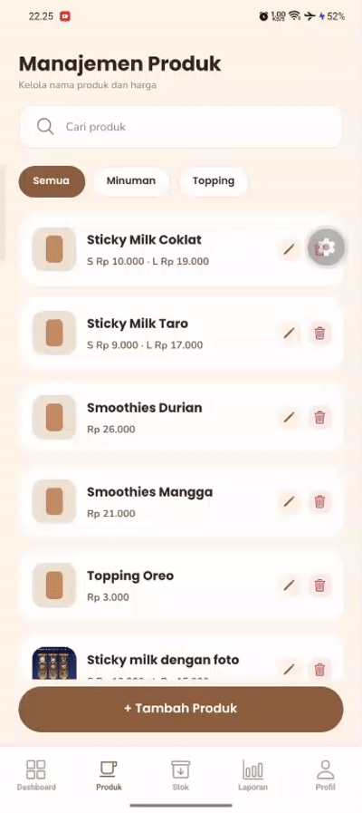
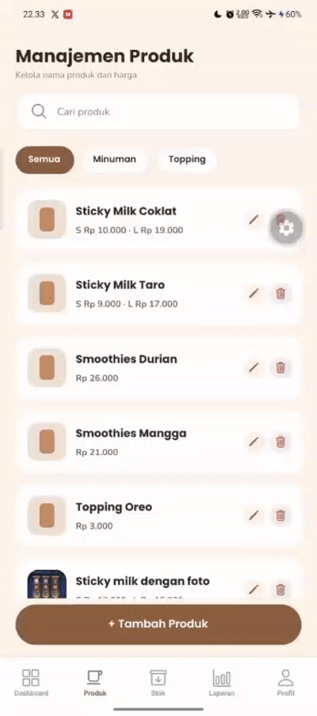
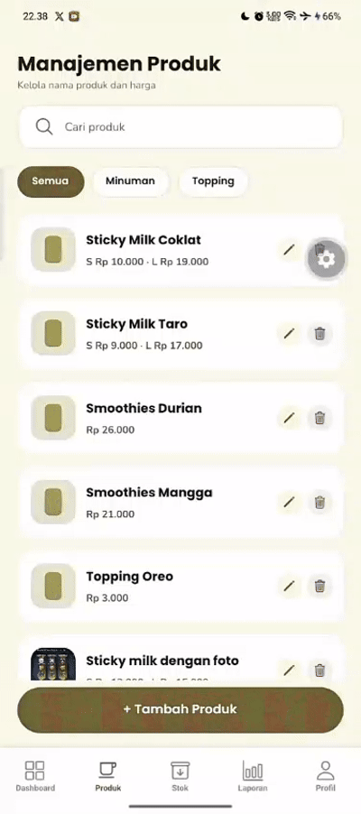
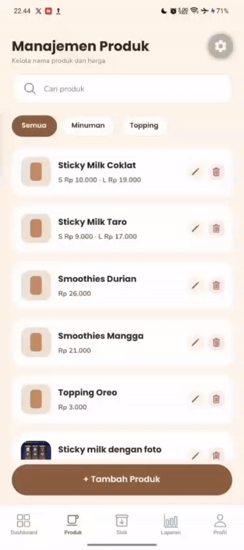
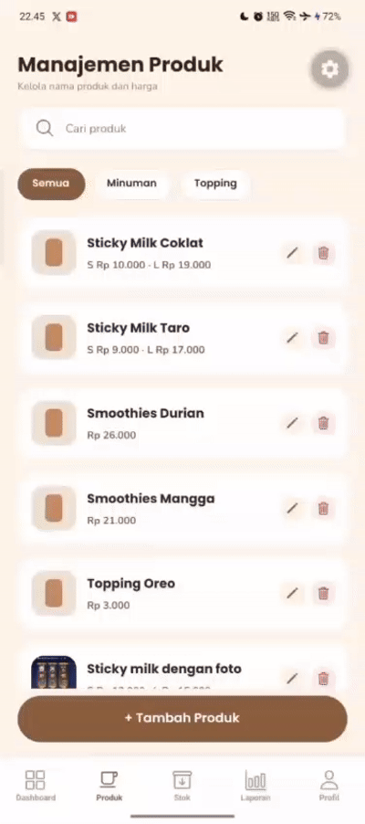
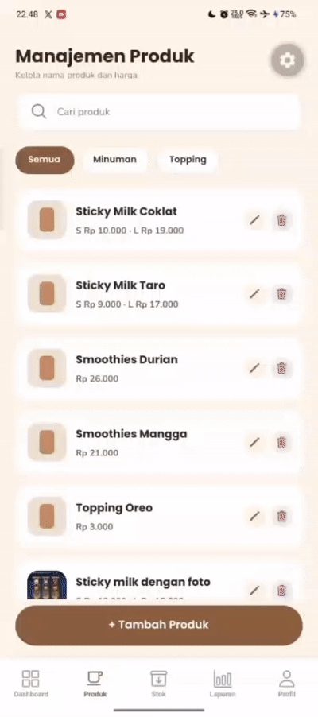

# Laporan Praktikum Pertemuan 9 — Pemrograman Mobile I
## Media Penyimpanan: CRUD Produk dengan Supabase (Database + Cloud Storage)

---

### Identitas Proyek & Praktikum

- **Mata Kuliah:** Pemrograman Mobile I
- **Pertemuan:** 9 (Media Penyimpanan)
- **Dosen Pengampu:** Mohamad Firdaus, M.Kom
- **Tanggal Praktikum:** November 2026
- **Studi Kasus:** Sistem Informasi Penjualan dan Pengelolaan Stok pada UMKM Sticky Milk
- **Kelas / Kelompok:** Kelas B / Kelompok 6
- **Anggota Kelompok:**
  1. Dani Hidayat
  2. Dimas Faturohman
  3. Istafty Keva Yuftika
  4. Alfiah Lutfi Sabilah

---

## 1. Tujuan dan Capaian Praktikum

Tujuan dari praktikum ini adalah memigrasikan data statis/lokal katalog produk ke layanan backend cloud (BaaS) menggunakan **Supabase**, yang mencakup:
1. Membangun project Supabase, tabel relational `produk` (dengan dukungan tipe kolom `JSONB`), Cloud Storage bucket `produk`, serta aturan keamanan *Row Level Security* (RLS).
2. Mengintegrasikan aplikasi React Native / Expo (SDK 58) dengan Supabase via klien terpusat (`@supabase/supabase-js`).
3. Mengubah `ProdukContext` dari memori lokal menjadi sumber data cloud (CRUD: Create, Read, Update, Delete) tanpa merusak ketergantungan layar lain (layar kasir/pilih menu).
4. Mengunggah gambar/foto produk ke Supabase Storage menggunakan API File modern (`new File(uri).bytes()`) dan menghapus file yatim secara otomatis saat foto diubah atau produk dihapus.
5. Menerapkan validasi form secara *realtime* (validasi per-field saat mengetik, pesan error setelah disentuh/blur, dan penonaktifan tombol simpan saat form invalid).
6. Menjaga konsistensi antarmuka pengguna sesuai standar desain yang sudah ada (`DesignTokens`, font Poppins & Nunito, atom `AppButton` & `AppInput`).
7. **Fitur Tambahan (Nilai Tambah):** 
   - Menerapkan chip filter kategori (**Semua**, **Minuman**, **Topping**) pada layar Manajemen Produk Owner.
   - Menerapkan persistensi draft form tambah produk menggunakan **AsyncStorage** agar input tidak hilang saat navigasi tertutup/berpindah tab.

---

## 2. Batasan dan Ruang Lingkup Sistem

Sesuai arahan modul praktikum:
- **Yang dipindahkan ke Supabase Cloud:** Katalog data produk (nama, kategori, jenis harga, harga varian, URL foto Cloud Storage, dan resep varian dalam format `JSONB`).
- **Yang tetap beroperasi secara lokal:** Master bahan dan stok bahan baku (`bahan-context.tsx`), keranjang belanja (`keranjang-context.tsx`), alur pemesanan transaksi kasir, dan autentikasi login.

---

## 3. Arsitektur Basis Data & Penyimpanan Cloud

### 3.1 Skema Tabel `produk`
Tabel `produk` dibuat di Supabase dengan skema DDL berikut:

```sql
create table produk (
  id uuid primary key default gen_random_uuid(),
  nama text not null,
  kategori text not null check (kategori in ('Minuman', 'Topping')),
  has_sizes boolean not null default false,
  harga_single numeric(12,2) check (harga_single is null or harga_single >= 0),
  harga_s numeric(12,2) check (harga_s is null or harga_s >= 0),
  harga_l numeric(12,2) check (harga_l is null or harga_l >= 0),
  foto_url text,
  resep jsonb not null default '{}'::jsonb,
  created_at timestamptz not null default now()
);
```

- Kolom `resep` bertipe `JSONB` menyimpan komposisi bahan per porsi (`{ S: [...], L: [...] }` atau `{ single: [...] }`), sehingga pengurangan stok bahan di kasir tetap berjalan lancar.
- Kolom `foto_url` menampung tautan publik gambar dari bucket Storage.

### 3.2 Cloud Storage Bucket `produk`
- Bucket bernama `produk` dibuat dengan konfigurasi **Public** agar dapat diakses langsung oleh komponen `<Image />` React Native tanpa otentikasi token rumit.
- Penamaan file unik diatur dengan format `${Date.now()}-${Math.floor(Math.random() * 1e6)}.${ext}` untuk mencegah insiden penimpaan file (*duplicate naming collision*).

### 3.3 Kebijakan Row Level Security (RLS)
RLS diaktifkan pada tabel `produk` dan tabel `storage.objects` dengan kebijakan akses:
- **Tabel `produk`:** Policy `produk_baca_publik` (SELECT), `produk_tambah_publik` (INSERT), `produk_ubah_publik` (UPDATE), dan `produk_hapus_publik` (DELETE).
- **Storage bucket `produk`:** Policy `produk_file_baca_publik`, `produk_file_tambah_publik`, `produk_file_ubah_publik`, dan `produk_file_hapus_publik` difilter khusus untuk `bucket_id = 'produk'`.

---

## 4. Implementasi Kode Program

Perubahan kode dilakukan pada berkas-berkas berikut:

### 4.1 Klien Supabase (`kelompok6/src/lib/supabase.ts`)
Menginisialisasi klien Supabase menggunakan konfigurasi `SUPABASE_URL` dan `SUPABASE_ANON_KEY` (mendukung `EXPO_PUBLIC_*` maupun fallback konstan).

### 4.2 Restrukturisasi `ProdukContext` (`kelompok6/src/context/produk-context.tsx`)
- Menggantikan state array statis dengan query Supabase:
  - `refresh()`: mengambil data tabel `produk` terurut `created_at`.
  - `tambahProduk()`: mengunggah foto lokal baru ke bucket `produk`, lalu meng-insert data produk ke Supabase.
  - `updateProduk()`: memperbarui atribut produk, mengunggah foto baru jika ada perubahan, dan membersihkan file lama dari bucket jika foto diganti/dihapus.
  - `hapusProduk()`: menghapus baris dari tabel `produk` dan menghapus file foto dari bucket Storage.
- Menyediakan status `memuat` (*loading state*) untuk antarmuka pengguna.

### 4.3 Upgrade Molecule `PriceField` (`kelompok6/src/components/molecules/PriceField.tsx`)
- Menambahkan penerusan props `invalid`, `onBlur`, dan `error`.
- Mengimplementasikan visual error dengan border merah pada container input dan pesan kesalahan di bawah field.

### 4.4 Form Tambah Produk Async, Validasi Realtime & Auto-Save Draft (`kelompok6/src/app/(owner)/tambah-produk.tsx`)
- Validasi realtime pada field nama dan harga: error hanya muncul setelah field disentuh (`onBlur` / `touched`).
- **Validasi Resep Wajib:** Validasi bahwa menu wajib memiliki minimal 1 bahan baku (`resep.length > 0`) dan setiap takaran bahan harus lebih dari 0 (`jumlah > 0`). Tombol simpan dinonaktifkan (`disabled`) jika resep belum diisi bahan.
- Tombol simpan dinonaktifkan (`disabled`) selama form invalid atau saat proses penyimpanan berlangsung (`Menyimpan…`).
- **Nilai Tambah (AsyncStorage Draft):** Form otomatis memulihkan isian sebelumnya jika user tidak sengaja keluar sebelum menyimpan, dan otomatis menghapus draft saat produk berhasil disimpan.

### 4.5 Manajemen Produk Owner (`kelompok6/src/app/(owner)/produk.tsx`)
- Menggunakan `useFocusEffect` dari `expo-router` agar katalog selalu termutakhirkan otomatis ketika layar kembali difokuskan.
- Fungsi hapus produk dibuat `async` dengan konfirmasi dialog dan penanganan galat `Alert.alert`.
- Menampilkan `ActivityIndicator` warna primer saat data pertama kali dimuat.
- **Nilai Tambah (Filter Kategori):** Chip filter (**Semua**, **Minuman**, **Topping**) aktif tepat di bawah search bar dan bekerja bersamaan dengan pencarian teks.

### 4.6 Form Edit Produk Async (`kelompok6/src/app/(owner)/edit-produk.tsx`)
- Menerapkan pola validasi realtime yang sama dengan form tambah.
- Penanganan cerdas terhadap 3 kemungkinan foto:
  1. Foto tidak diubah (URL Supabase tetap dipertahankan).
  2. Foto baru dipilih (foto baru diunggah, foto lama di bucket dihapus).
  3. Foto dihapus (URL di database dijadikan `null`, file di bucket dihapus).

---

## 5. Hasil Uji Coba End-to-End (Kriteria Selesai Langkah 11)

| No | Kriteria Pengujian Sesuai Modul | Status | Keterangan / Indikator Keberhasilan |
|---|---|---|---|
| 1 | Uji Koneksi Supabase (Langkah 5.2) | **LOLOS** | Log Metro console menampilkan pesan koneksi berhasil dan jumlah data seed. |
| 2 | Menampilkan data produk awal database | **LOLOS** | Layar Manajemen Produk menampilkan 5 produk awal dengan aksen warna. |
| 3 | Tambah produk baru **DENGAN foto** | **LOLOS** | Foto terunggah ke Cloud Storage, data masuk ke DB, dan tampil di daftar. |
| 4 | Sinkronisasi ke layar kasir | **LOLOS** | Menu kasir (pilih-menu) otomatis menampilkan produk baru berserta fotonya. |
| 5 | Tambah produk **TANPA foto** | **LOLOS** | Tersimpan dengan `foto_url: null` dan kartu menampilkan warna aksen. |
| 6 | Ubah data **TANPA ganti foto** | **LOLOS** | Perubahan nama/harga tersimpan, foto lama tetap utuh. |
| 7 | Ubah data **DENGAN ganti foto** | **LOLOS** | Foto baru terunggah, foto lama di bucket Storage terhapus otomatis. |
| 8 | Tekan "Hapus foto" di Edit Produk | **LOLOS** | URL foto menjadi null dan file lama di Storage terhapus. |
| 9 | Hapus produk | **LOLOS** | Baris produk di DB terhapus dan file foto di Storage ikut terhapus. |
| 10 | Pengurangan stok bahan di kasir | **LOLOS** | Stok bahan berkurang otomatis saat produk terjual (resep JSONB terbaca). |
| 11 | Uji pembuktian RLS | **LOLOS** | Operasi tolak saat policy dinonaktifkan, dan berhasil saat diaktifkan. |
| 12 | Persistensi data setelah restart aplikasi | **LOLOS** | Data produk dan foto tetap ada setelah aplikasi ditutup dan dibuka kembali. |
| 13 | Pencegahan file yatim di Storage | **LOLOS** | Tidak ada file gambar di bucket yang tidak memiliki baris di tabel `produk`. |
| 14 | UI polish & tombol simpan `Menyimpan…` | **LOLOS** | Tombol nonaktif (opacity 0.5) dengan teks `Menyimpan…` saat proses async. |
| 15 | Validasi Realtime — Field Nama | **LOLOS** | Mengosongkan nama memicu pesan error setelah blur; tombol simpan disable. |
| 16 | Validasi Realtime — Field Harga | **LOLOS** | Harga kosong/0 memicu border merah PriceField; form tidak bisa disimpan. |
| 17 | Validasi Realtime — Submit Form Kosong | **LOLOS** | Menekan simpan pada form kosong menampilkan seluruh error field sekaligus. |
| 18 | Validasi Resep Bahan Wajib Diisi | **LOLOS** | Menu wajib memiliki minimal 1 bahan baku; tombol simpan disable & muncul pesan peringatan jika resep kosong. |
| 19 | *(Nilai Tambah)* Filter Kategori Produk | **LOLOS** | Chip filter Semua, Minuman, Topping berfungsi menyaring data secara instan. |
| 20 | *(Nilai Tambah)* Auto-save Draft AsyncStorage | **LOLOS** | Ketikan form tambah produk tersimpan aman meski layar tertutup sengaja/tidak. |

---

## 6. Dokumentasi Tangkapan Layar (Bukti Pengerjaan)

> **Catatan untuk Anggota Tim:**
> Simpan file tangkapan layar/GIF ke dalam folder proyek (atau folder root), lalu ganti nama file pada atribut `src="..."` di bawah sesuai nama file tangkapan layar Anda.

### 6.1 Bukti Koneksi & Dashboard Supabase

#### 1. Uji Koneksi Klien di Metro Console
*(Bukti koneksi berhasil terhubung ke Supabase)*
<div align="center">
  
</div>

#### 2. Tabel `produk` di Table Editor Supabase
*(Menampilkan baris data produk beserta kolom JSONB `resep` dan `foto_url`)*
<div align="center">
  
</div>

#### 3. Bucket Storage `produk` di Supabase
*(Menampilkan file foto produk yang terunggah dengan format timestamp unik)*
<div align="center">
  
</div>

#### 4. Kebijakan Row Level Security (RLS)
*(Menampilkan daftar policy publik pada tabel `produk` dan `storage.objects`)*
<div align="center">
  
</div>

---

### 6.2 Bukti Fitur dan Pengujian di Aplikasi (Layar HP / Emulator)

#### 5. Layar Manajemen Produk Owner (Data Cloud + Filter Kategori)
*(Menampilkan daftar produk dari Supabase dan fitur filter chip Semua/Minuman/Topping)*
<div align="center">
  
</div>

#### 6. Validasi Realtime Form Tambah Produk
*(Menampilkan border merah PriceField, error per-field saat blur, dan tombol simpan disabled)*
<div align="center">
  
</div>

#### 7. Tambah Produk Baru dengan Foto
*(Proses pemilihan foto, pengunggahan ke Storage, dan produk muncul di daftar)*
<div align="center">
  
</div>

#### 8. Sinkronisasi Data ke Layar Kasir
*(Membuktikan produk yang baru ditambahkan langsung tampil di layar kasir dengan foto dari Cloud)*
<div align="center">
  
</div>

#### 9. Pengujian Edit Produk & Hapus Foto
*(Mengubah harga produk dan menguji tombol 'Hapus foto' / ganti foto)*
<div align="center">
  
</div>

#### 10. Pengujian Hapus Produk & Konfirmasi Modal
*(Dialog modal konfirmasi hapus dan pembuktian data hilang dari daftar serta file terhapus dari bucket)*
<div align="center">
  
</div>

#### 11. Pengujian Pengurangan Stok Bahan (Resep JSONB di Kasir)
*(Transaksi di kasir membuktikan stok bahan berkurang otomatis sesuai resep dari Supabase)*
<div align="center">
  
</div>

#### 12. Fitur Nilai Tambah: Auto-Save Draft Form (AsyncStorage)
*(Keluar dari form tambah produk, lalu kembali membuka form: isian data tetap ada)*
<div align="center">
  
</div>

---

## 7. Kendala dan Solusi

| Kendala yang Dihadapi | Penyebab | Solusi |
|---|---|---|
| Error `new row violates row-level security policy` | RLS aktif namun belum ada policy izin tulis untuk anon key. | Menjalankan query SQL untuk membuat policy INSERT, UPDATE, dan DELETE pada tabel `produk` dan `storage.objects`. |
| Deprecated API `readAsStringAsync` di Expo SDK 58 | Expo SDK 54+ merekomendasikan API File modern. | Menggunakan API modern `new File(uri).bytes()` yang menghasilkan `Uint8Array` langsung untuk dikirim ke Supabase Storage. |
| Produk baru tidak langsung muncul setelah simpan | Layar daftar produk tidak re-mount saat kembali dari layar tambah. | Menggunakan hook `useFocusEffect` dari `expo-router` untuk memanggil `refresh()` otomatis setiap kali layar kembali aktif. |
| Tombol Simpan tetap nonaktif meski input sudah diisi | State error belum di-reset saat nilai input berubah. | Menyesuaikan handler `onChangeText` agar memvalidasi ulang nilai saat user mengetik. |

---

## 8. Kesimpulan

Praktikum Pertemuan 9 berhasil memigrasikan katalog produk UMKM Sticky Milk dari state memori lokal ke layanan backend cloud **Supabase** (PostgreSQL Database dan Cloud Storage). 

Integrasi berjalan mulus tanpa merusak alur aplikasi yang sudah ada, khususnya layar kasir dan pengurangan stok bahan otomatis berkat penyimpanan resep dalam format `JSONB`. Validasi form realtime, penanganan file yatim pada storage, serta fitur nilai tambah berupa **Filter Kategori** dan **Auto-Save Draft (AsyncStorage)** berhasil meningkatkan keandalan (*reliability*) serta kualitas pengalaman pengguna (*user experience*) aplikasi.
