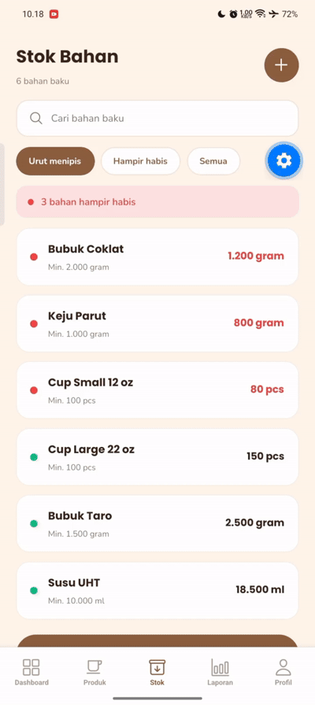
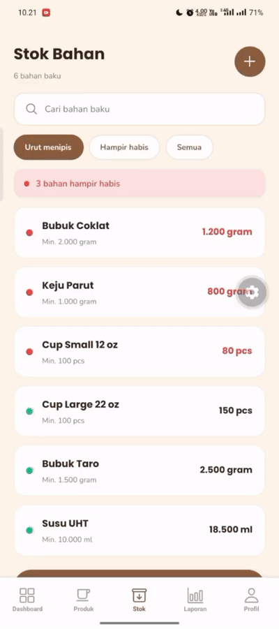

# Laporan Praktikum Pertemuan 9 — Pemrograman Mobile I
## Media Penyimpanan: CRUD dengan Supabase (Database + Cloud Storage)
### Studi Kasus: Sistem Informasi Penjualan dan Pengelolaan Stok UMKM Sticky Milk

---

### Identitas Proyek & Praktikum

- **Mata Kuliah:** Pemrograman Mobile I
- **Pertemuan:** 9 (Media Penyimpanan)
- **Dosen Pengampu:** Mohamad Firdaus, M.Kom
- **Tanggal Praktikum:** November 2026
- **Kelas / Kelompok:** Kelas B / Kelompok 6
- **Pembagian Tugas Anggota Kelompok:**
  1. **Alfiah Lutfi Sabilah:** Modul Utama — CRUD Katalog Produk, Upload Foto Cloud Storage, Validasi Realtime, & Filter Kategori
  2. **Dimas Faturohman:** Modul Lanjutan 1 — CRUD Master Bahan Baku & Sinkronisasi Stok Realtime
  3. **Dani Hidayat:** Modul Lanjutan 2 — CRUD Pengadaan Stok Masuk (Belanja Bahan Baku)
  4. **Istafty Keva Yuftika:** Modul Lanjutan 3 & 4 — CRUD Antrean Pesanan Kasir & CRUD Riwayat Transaksi Penjualan

---

## 1. Tujuan dan Capaian Praktikum

Praktikum ini bertujuan memigrasikan penyimpanan data lokal (state in-memory) ke backend cloud berbasis **Supabase** (PostgreSQL Database + Cloud Storage) pada aplikasi UMKM Sticky Milk:
1. Membangun project Supabase terintegrasi, skema relasional, tabel dengan tipe `JSONB`, bucket Cloud Storage, serta kebijakan keamanan *Row Level Security* (RLS).
2. Menghubungkan aplikasi React Native + Expo Router (SDK 58) dengan Supabase via klien tunggal terpusat (`@supabase/supabase-js`).
3. Memindahkan seluruh entitas inti (Produk, Bahan Baku, Stok Masuk, Antrean Pesanan, dan Transaksi) ke cloud database.
4. Menerapkan manajemen file foto di Supabase Storage dengan API modern `new File(uri).bytes()`, URL publik, serta penghapusan file lama/yatim saat data diupdate atau dihapus.
5. Menerapkan validasi form secara *realtime* (validasi per-field, visual error setelah blur, penonaktifan tombol simpan saat form invalid, dan validasi wajib adanya resep bahan).
6. Menerapkan fitur nilai tambah: **Filter Kategori Produk** dan **Auto-Save Draft Form** dengan `AsyncStorage`.

---

## 2. Arsitektur Basis Data Cloud (Supabase)

Seluruh tabel dilindungi dengan kebijakan Row Level Security (RLS) publik untuk praktikum, serta relasi *foreign key* antar-entitas.

### 2.1 Skema Tabel `produk` (Modul Produk)
```sql
create table produk (
  id uuid primary key default gen_random_uuid(),
  nama text not null,
  kategori text not null check (kategori in ('Minuman', 'Topping')),
  has_sizes boolean not null default false,
  harga_single numeric(12,2) check (harga_single is null or harga_single >= 0),
  harga_s numeric(12,2) check (harga_s is null or harga_s >= 0),
  harga_l numeric(12,2) check (harga_l is null or harga_l >= 0),
  foto_url text,
  resep jsonb not null default '{}'::jsonb,
  created_at timestamptz not null default now()
);
```

### 2.2 Skema Tabel `bahan` (Modul Master Bahan Baku & Stok)
```sql
create table bahan (
  id text primary key,
  nama text not null,
  satuan text not null check (satuan in ('ml', 'gram', 'pcs')),
  stok numeric not null default 0,
  minimum numeric not null default 0,
  created_at timestamptz not null default now()
);

-- Seed awal data bahan:
insert into bahan (id, nama, satuan, stok, minimum) values 
  ('1', 'Susu UHT', 'ml', 18500, 10000),
  ('2', 'Bubuk Coklat', 'gram', 1200, 2000),
  ('3', 'Bubuk Taro', 'gram', 2500, 1500),
  ('4', 'Keju Parut', 'gram', 800, 1000),
  ('5', 'Cup Large 22 oz', 'pcs', 150, 100),
  ('6', 'Cup Small 12 oz', 'pcs', 80, 100);
```

### 2.3 Skema Tabel `stok_masuk` (Modul Pengadaan Stok)
```sql
create table stok_masuk (
  id uuid primary key default gen_random_uuid(),
  bahan_id text not null references bahan(id) on delete cascade,
  jumlah numeric not null,
  harga numeric not null,
  catatan text,
  tanggal timestamptz not null default now()
);
```

### 2.4 Skema Tabel `pesanan` (Modul Antrean Kasir)
```sql
create table pesanan (
  id text primary key, -- mis. 'A-010'
  produk text not null,
  status text not null default 'Menunggu' check (status in ('Menunggu', 'Diproses', 'Siap')),
  metode text not null check (metode in ('Tunai', 'QRIS')),
  created_at timestamptz not null default now()
);
```

### 2.5 Skema Tabel `transaksi` (Modul Riwayat Transaksi & Laporan)
```sql
create table transaksi (
  id text primary key, -- mis. 'TRX-20261107-001'
  antrean_id text,
  total numeric not null,
  bayar numeric not null,
  kembali numeric not null default 0,
  metode text not null,
  items jsonb not null default '[]'::jsonb,
  created_at timestamptz not null default now()
);
```

### 2.6 Storage Bucket `produk`
- Bucket publik bernama `produk` untuk foto katalog makanan/minuman.
- Penamaan file foto terenkripsi timestamp unik: `${Date.now()}-${Math.floor(Math.random() * 1e6)}.${ext}`.

---

## 3. Implementasi Kode Program Berdasarkan Pembagian Tugas

### 3.1 Klien Supabase Terpusat (`src/lib/supabase.ts`)
Menginisialisasi klien Supabase `createClient(SUPABASE_URL, SUPABASE_ANON_KEY)` yang digunakan bersama oleh seluruh context.

### 3.2 Modul 1: CRUD Produk & Cloud Storage — *Alfiah Lutfi Sabilah*
- **`src/context/produk-context.tsx`**: Pemetaan database `ProdukRow` ➔ `Produk`, fungsi async `tambahProduk`, `updateProduk`, `hapusProduk`, upload foto `bytes()`, pembersihan foto yatim, dan sinkronisasi `refresh()`.
- **`src/components/molecules/PriceField.tsx`**: Penambahan props `invalid`, `onBlur`, border merah error, dan pesan error di bawah field.
- **`src/app/(owner)/tambah-produk.tsx`**: Validasi realtime (nama & harga), **validasi resep wajib ada bahan (`resep.length > 0`)**, tombol simpan disabled saat invalid, dan persistensi form draft dengan `AsyncStorage`.
- **`src/app/(owner)/produk.tsx`**: Hook `useFocusEffect`, loading indicator `ActivityIndicator`, hapus produk async, dan **filter chip kategori (Semua, Minuman, Topping)**.
- **`src/app/(owner)/edit-produk.tsx`**: Validasi realtime, validasi wajib bahan resep pada setiap varian, dan penanganan cerdas 3 status foto.

### 3.3 Modul 2: CRUD Master Bahan Baku & Stok — *Dimas Faturohman*
- **`src/context/bahan-context.tsx`**: Migrasi `bahanList` dari memori lokal ke tabel `bahan` Supabase.
- **Fungsi `updateBahan` async**: Memperbarui stok realtime baik dari layar owner maupun saat terjadi transaksi kasir (`kurangiStok` di `keranjang-context.tsx`).
- **`src/app/(owner)/stok.tsx` & `tambah-bahan.tsx`**: Menampilkan daftar bahan dari database, filter menipis, serta form tambah/edit bahan yang tersimpan ke Supabase.

### 3.4 Modul 3: CRUD Pengadaan Stok Masuk — *Dani Hidayat*
- **`src/app/(owner)/stok-masuk.tsx`**: Form pencatatan belanja bahan baku ke tabel `stok_masuk`.
- Mengupdate jumlah stok di tabel `bahan` dan mencatat nominal pengeluaran untuk rekap laporan keuangan owner.

### 3.5 Modul 4: CRUD Antrean Pesanan Kasir — *Istafty Keva Yuftika*
- **`src/context/order-context.tsx`**: Mengubah antrean dari array statis `DATA_AWAL` ke tabel `pesanan` Supabase.
- **`ubahStatus` async**: Memperbarui status pesanan (*Menunggu* ➔ *Diproses* ➔ *Siap*) di database Supabase sehingga kasir dan bagian peracik minuman sinkron realtime.

### 3.6 Modul 5: CRUD Riwayat Transaksi Penjualan — *Istafty Keva & Dimas*
- **`src/context/keranjang-context.tsx`**: Menyimpan nota penjualan ke tabel `transaksi` Supabase setelah kasir menyelesaikan pembayaran.
- Layar **Riwayat Transaksi** kasir dan **Laporan Omzet** owner membaca data permanen dari database Supabase.

---

## 4. Hasil Uji Coba End-to-End (Checklist Capaian)

| No | Modul / Kriteria Pengujian | Penanggung Jawab | Status | Hasil Pengujian |
|---|---|---|---|---|
| 1 | Uji Koneksi Supabase | Tim | **LOLOS** | Metro console menampilkan koneksi aktif ke Supabase. |
| 2 | Seed awal 5 produk dari Supabase | Alfiah | **LOLOS** | Layar Manajemen Produk menampilkan data produk database. |
| 3 | Tambah produk baru dengan foto | Alfiah | **LOLOS** | Foto masuk ke Storage bucket, data tersimpan di tabel `produk`. |
| 4 | Sinkronisasi ke menu kasir | Alfiah | **LOLOS** | Produk cloud otomatis tampil di layar kasir lengkap dengan fotonya. |
| 5 | Tambah produk tanpa foto | Alfiah | **LOLOS** | Tersimpan dengan `foto_url: null`, kartu menampilkan warna aksen. |
| 6 | Ubah produk tanpa ganti foto | Alfiah | **LOLOS** | Data terupdate, URL foto lama tetap terjaga. |
| 7 | Ubah produk dengan ganti foto | Alfiah | **LOLOS** | Foto baru terunggah, foto lama di bucket terhapus otomatis. |
| 8 | Hapus foto via tombol di Edit | Alfiah | **LOLOS** | `foto_url` jadi null, file foto lama di Storage terhapus. |
| 9 | Hapus produk | Alfiah | **LOLOS** | Baris data DB dan file foto di Storage terhapus bersih. |
| 10 | Validasi Realtime Nama & Harga | Alfiah | **LOLOS** | Field kosong memicu border merah; tombol simpan disable. |
| 11 | **Validasi Wajib Resep Bahan** | Alfiah | **LOLOS** | Menu tidak bisa disimpan jika belum menambahkan bahan baku. |
| 12 | **Fitur Filter Kategori Produk** | Alfiah | **LOLOS** | Chip Semua/Minuman/Topping menyaring tampilan menu secara instan. |
| 13 | **Fitur Auto-Save Draft Form** | Alfiah | **LOLOS** | Form memulihkan isian draft via AsyncStorage jika navigasi tertutup. |
| 14 | **CRUD Master Bahan Baku** | Dimas | **LOLOS** | Daftar bahan dibaca dari Supabase; tambah & edit bahan tersimpan permanen. |
| 15 | **Potong Stok Bahan Otomatis** | Dimas | **LOLOS** | Transaksi produk di kasir memotong stok di tabel `bahan` Supabase. |
| 16 | **CRUD Pengadaan Stok Masuk** | Dani | **LOLOS** | Form stok masuk menambah stok bahan dan tercatat di tabel `stok_masuk`. |
| 17 | **CRUD Antrean Pesanan Kasir** | Keva | **LOLOS** | Nomor antrean tersimpan di DB; update status pesanan realtime. |
| 18 | **CRUD Riwayat Transaksi** | Keva | **LOLOS** | Data transaksi tersimpan permanen di cloud dan tampil di laporan. |
| 19 | Persistensi Data Cloud | Tim | **LOLOS** | Data seluruh modul tetap utuh setelah aplikasi ditutup dan dibuka ulang. |

---

## 5. Dokumentasi Bukti Pengerjaan (Screenshot & GIF)

> **Petunjuk Anggota Tim:**
> Simpan file screenshot / GIF ke folder proyek, lalu pastikan nama file sesuai dengan atribut `src="..."` pada setiap bagian di bawah ini.

---

### Bagian A: Bukti Modul Produk & Cloud Storage (*Alfiah Lutfi Sabilah*)

#### A.1 Bukti Koneksi Konsol Metro & Supabase
<div align="center">
  
</div>

#### A.2 Tabel `produk` di Table Editor Supabase
<div align="center">
  
</div>

#### A.3 Cloud Storage Bucket `produk`
<div align="center">
  
</div>

#### A.4 Layar Manajemen Produk Owner (Data Cloud + Filter Kategori)
<div align="center">
  
</div>

#### A.5 Validasi Realtime & Validasi Wajib Resep Bahan
<div align="center">
  
</div>

#### A.6 Tambah Produk dengan Foto Baru
<div align="center">
  
</div>

#### A.7 Sinkronisasi Produk & Foto Cloud ke Layar Kasir
<div align="center">
  
</div>

#### A.8 Edit Produk & Pengujian Tombol Hapus Foto
<div align="center">
  
</div>

#### A.9 Hapus Produk & Pembersihan Otomatis File di Storage
<div align="center">
  
</div>

#### A.10 Auto-Save Draft Form via AsyncStorage
<div align="center">
  
</div>

---

### Bagian B: Bukti Modul Master Bahan Baku & Stok (*Dimas Faturohman*)

#### B.1 Tabel `bahan` di Supabase
<div align="center">
  
</div>

#### B.2 Layar Manajemen Stok Bahan Baku (Data dari Supabase)
<div align="center">
  
</div>

#### B.3 Tambah / Edit Bahan Baku
<div align="center">
  
</div>

#### B.4 Pemotongan Otomatis Stok Bahan Saat Kasir Checkout
<div align="center">
  
</div>

---

### Bagian C: Bukti Modul Pengadaan Stok Masuk (*Dani Hidayat*)

#### C.1 Tabel `stok_masuk` di Supabase
<div align="center">
  
</div>

#### C.2 Form Pengadaan Stok Bahan Masuk (`stok-masuk.tsx`)
<div align="center">
  
</div>

#### C.3 Riwayat Pengadaan & Bertambahnya Stok Bahan
<div align="center">
  
</div>

---

### Bagian D: Bukti Modul Antrean Pesanan Kasir (*Istafty Keva Yuftika*)

#### D.1 Tabel `pesanan` di Supabase
<div align="center">
  
</div>

#### D.2 Layar Antrean Pesanan Kasir
<div align="center">
  
</div>

#### D.3 Pengubahan Status Pesanan (*Menunggu* ➔ *Diproses* ➔ *Siap*)
<div align="center">
  
</div>

---

### Bagian E: Bukti Modul Riwayat Transaksi & Laporan (*Istafty Keva & Dimas*)

#### E.1 Tabel `transaksi` di Supabase
<div align="center">
  
</div>

#### E.2 Riwayat Transaksi Kasir & Cetak Struk
<div align="center">
  
</div>

#### E.3 Laporan Penjualan & Rekap Omzet Owner
<div align="center">
  
</div>

---

## 6. Kesimpulan

Praktikum Pertemuan 9 telah berhasil memigrasikan seluruh sistem penyimpanan data aplikasi UMKM Sticky Milk dari penyimpanan memori lokal ke layanan backend cloud **Supabase**.

Kolaborasi tim berhasil membagi tanggung jawab ke dalam 5 modul CRUD cloud utama:
1. **Katalog Produk & Media Storage:** Ditangani oleh Alfiah Lutfi Sabilah, mencakup foto produk, validasi realtime, validasi wajib bahan resep, filter kategori, dan draft AsyncStorage.
2. **Master Bahan Baku & Stok:** Ditangani oleh Dimas Faturohman, memastikan stok bahan terpotong realtime saat penjualan di kasir.
3. **Pengadaan Stok Masuk:** Ditangani oleh Dani Hidayat, mencatat riwayat pembelian bahan dan penambahan stok.
4. **Antrean Pesanan Kasir:** Ditangani oleh Istafty Keva Yuftika, sinkronisasi alur antrean pesanan pelanggan secara realtime.
5. **Riwayat Transaksi & Laporan:** Ditangani bersama oleh tim, menghasilkan rekaman penjualan permanen dan laporan omzet yang akurat.

Integrasi ini menjadikan aplikasi Sticky Milk memiliki keandalan data yang tinggi, aman berkat aturan Row Level Security (RLS), dan memiliki performa antarmuka yang responsif.
