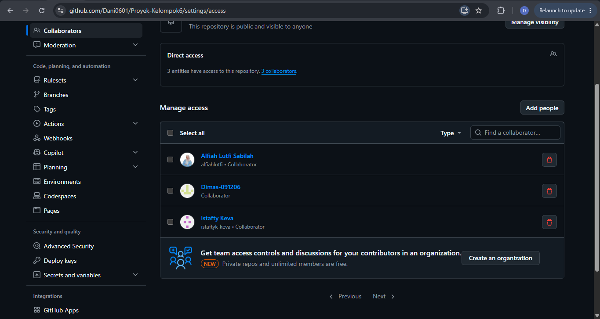
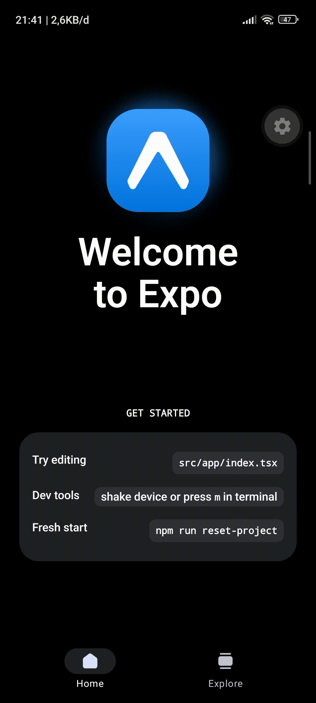

# Laporan Progres Kelompok 6 #
## Anggota Kelompok ##
1. Dani Hidayat
2. Dimas Fathurrohhman
3. Istafty Keva Yuftika
4. Alfiah Lutfi Sabilah

### Progres 1: Pertemuan 5 ###
1. PM membuat Repository dan invite member
2. Konfirmasi bukti

3. PM membuat inisialisasi proyek
4. Konfirmasi Bukti

Dimas :
1.
2.
3.
4.

Keva:
1.
2.
3.
4.

Alfiah:
1.
2.
3.
4.

Tugas Bersama:
1. Diskusi Penentuan Tema

# Notulen diskusi Kelompok 6 #
Nama Kelompok   : Kelompok 6
Hari/Tanggal    : Minggu, 11 OKtober 2026
Tempat/Media    : Google meet

## Agenda Diskusi ##
1.	Mengusulkan ide tema aplikasi mobile
2.	Menentukan target pengguna aplikasi

## Daftar Ide Tema ##

Dani:

Tema :
1. Sistem Informasi Akademik dan Administrasi Siswa pada MA Nurul Huda
2. Sistem Informasi Penjualan dan Pengelolaan Persediaan Produk pada UMKM Tellakrip

Target :
1. Staff TU dan Siswa
2. Pelaku usaha Tellakrip

Dimas :

Tema :
1. Sistem Informasi Pemesanan Jasa dan Pengelolaan Transaksi pada Bengkel Las Bubut

Target :
1. Pemilik usaha bengkel

Keva :

Tema :
1. Sistem Informasi Penjualan dan Pengelolaan Stok pada UMKM Sticky Milk

Target :
1. Pmeilik usaha Sticky milk

Alfiah :

Tema :
1. Sistem Informasi Akademik dan Pengelolaan Data Siswa pada SMP Tunas Bangsa
2. Sistem Informasi Persediaan dan Penjualan Material Baja pada Cirebon Steel Material

## Hasil dan Keputusan ##
Tema yang diusulkan: Inventaris UMKM
Alasan pemilihan:
1.	Melihat dari kapasitas tim
2.	UMKM Sticky Milk dipilih karena usaha di bidang minuman berpotensi membutuhkan sistem untuk membantu pencatatan transaksi penjualan, pengelolaan stok produk atau bahan baku, serta pembuatan laporan penjualan.

Target pengguna: Pemilik usaha Sticky milk

