# Progress Pengembangan 2 — PEMMOB
# 1. Penentuan Tema dan Wawancara
## 1.1 Identitas Proyek

- **Nama kelompok:** Kelompok 6
- **Mata kuliah:** Pemrograman Mobile (PEMMOB)
- **Nama aplikasi:** Sticky Milk
- **Tema proyek:** Sistem Informasi Penjualan dan Pengelolaan Stok pada UMKM Sticky Milk
- **Platform/teknologi:** React Native dengan Expo
- **Anggota kelompok:**
  1. Dani Hidayat
  2. Dimas Faturohman
  3. Istafty Keva Yuftika
  4. Alfiah Lutfi Sabilah

## 1.2 Tema Proyek dan Hasil Wawancara

### 1.2.1 Latar Belakang

Sticky Milk merupakan UMKM yang menjual produk minuman. Berdasarkan informasi wawancara yang telah dihimpun, usaha ini menjual beberapa produk, antara lain Longci, Sticky Milk, Magic Water, dan smoothies. Proses operasional masih memiliki beberapa kendala yang dapat menjadi dasar perancangan aplikasi.

### 1.2.2 Temuan Wawancara dan Kebutuhan Pengguna
Berdasarkan informasi yang diperoleh dari wawancara dengan pemilik UMKM Sticky Milk, terdapat beberapa kondisi operasional yang menjadi dasar dalam menentukan kebutuhan aplikasi.

1. Pencatatan transaksi penjualan belum terperinci

Transaksi penjualan, pendapatan, dan pengeluaran belum dicatat secara terperinci. Pemilik masih memperkirakan kondisi keuangan dengan membandingkan uang yang tersedia dengan pengeluaran untuk pembelian stok bahan baku.

Kebutuhan pengguna: Aplikasi perlu menyediakan fitur pencatatan transaksi penjualan serta riwayat transaksi agar data penjualan dapat terdokumentasi dengan lebih teratur.

2. Pemantauan stok bahan baku masih berdasarkan perkiraan

Pemantauan persediaan bahan baku dilakukan dengan memperkirakan kebutuhan dan memperhatikan bahan yang mulai habis, misalnya stok susu dalam kemasan karton dan buah mangga dalam satuan kilogram.

Kebutuhan pengguna: Aplikasi perlu menyediakan informasi produk dan stok agar pemilik dapat memantau persediaan serta mengetahui bahan atau produk yang perlu diperiksa dan ditambah.

3. Pengelolaan antrean pesanan belum terstruktur

Ketika kondisi penjualan sedang ramai, belum adanya nomor antrean yang teratur dapat menyebabkan pesanan pelanggan terlewat atau urutannya menjadi kurang jelas.

Kebutuhan pengguna: Aplikasi perlu menyediakan fitur antrean yang menampilkan nomor dan status pesanan sehingga pegawai dapat melayani pelanggan berdasarkan urutan yang lebih jelas.

4. Pemilik membutuhkan informasi penjualan yang lebih teratur

Pencatatan yang belum terperinci membuat pemilik perlu memperkirakan kondisi keuangan dari uang yang tersedia dan pengeluaran usaha.

Kebutuhan pengguna: Aplikasi perlu menyediakan riwayat transaksi dan ringkasan penjualan untuk membantu pemilik memantau aktivitas penjualan dan mengevaluasi kegiatan usaha.

5. Pelayanan perlu mendukung kepuasan pelanggan

Usaha Sticky Milk berupaya memberikan pelayanan yang baik kepada pelanggan dengan harga produk yang terjangkau. Oleh karena itu, proses transaksi dan pengelolaan antrean perlu dirancang agar mudah digunakan oleh pegawai.

Kebutuhan pengguna: Aplikasi perlu memiliki antarmuka yang sederhana, mudah dipahami, dan mendukung proses transaksi serta pemantauan antrean secara praktis.

### 1.2.3 Kesimpulan Kebutuhan Pengguna

Berdasarkan temuan tersebut, kebutuhan utama yang menjadi dasar rancangan aplikasi adalah:

1. Membantu pencatatan transaksi penjualan.
2. Menyediakan informasi produk dan stok.
3. Membantu pengaturan antrean pesanan.
4. Menampilkan riwayat serta ringkasan laporan penjualan.
5. Menyediakan antarmuka yang sederhana dan mudah dipahami oleh pemilik maupun pegawai.

**bukti wawancara:**

- **Narasumber:** Pemilik UMKM Sticky Milk 
- **Tanggal wawancara:**  Selasa, 13 Oktober 2026
- **Tempat:** Jl. Muhammad Toha
- **Bukti wawancara:** 

  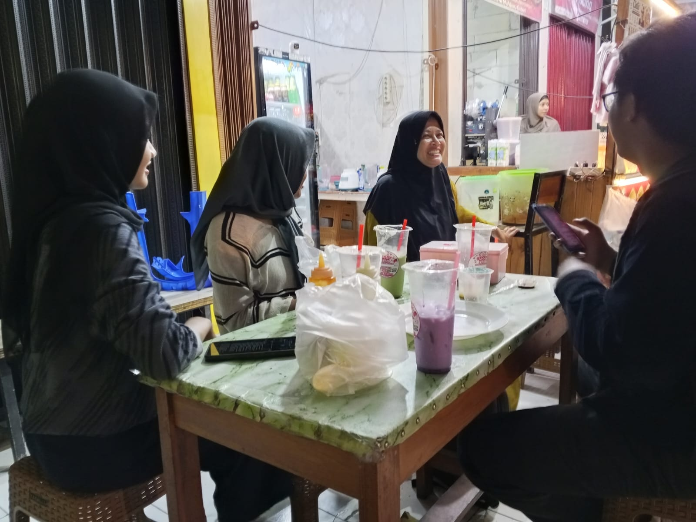
  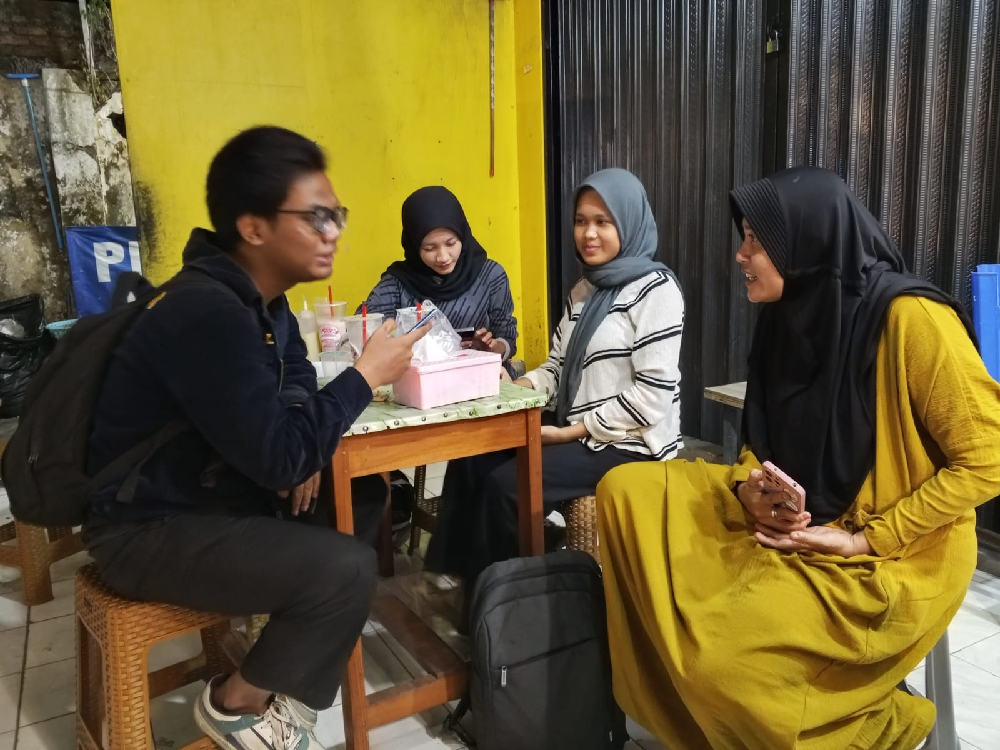

  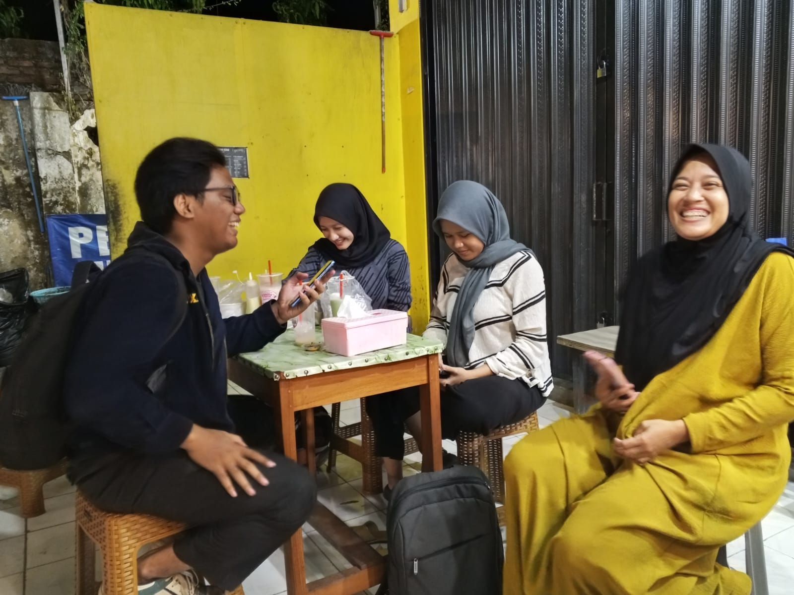
  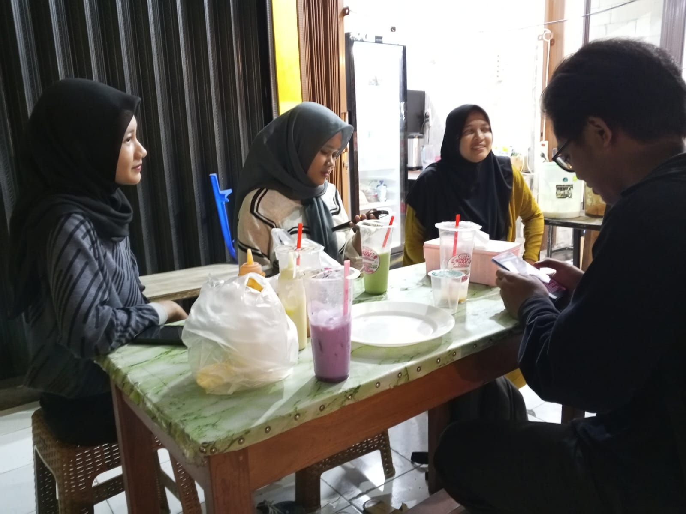

# 2. Pembagian Tugas
##  Role dan Hak Akses

**Owner/Pemilik** : Memantau ringkasan penjualan, produk/stok, riwayat transaksi, dan laporan : Login, Dashboard, Produk/Stok, Riwayat dan Laporan. 

**Kasir/Pegawai** : Melayani transaksi dan memantau urutan pesanan :  Login, Dashboard, Transaksi Penjualan, Antrean Pesanan, Produk.

## pembagian tugas

1. Dani : Login (Owner dan Kasir)
2. Alfiah : Dashboard, manajemen produk (owner)
3. Dimas : Transaksi penjualan (kasir)
4. Keva : Antrean pesanan (kasir), Riwayat dan laporan (owner dan kasir)

# 3. Rancangan Layar

## 1. *Login* - DANI
* *Fungsi utama:* Memvalidasi pengguna sebelum masuk ke aplikasi.
* *Role terkait:* Admin/Pemilik, Kasir/Pegawai
### Bukti Video/GIF Pengerjaan Layar

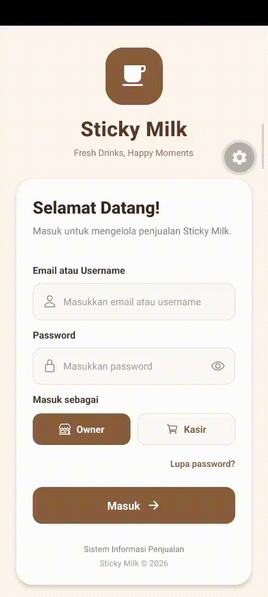

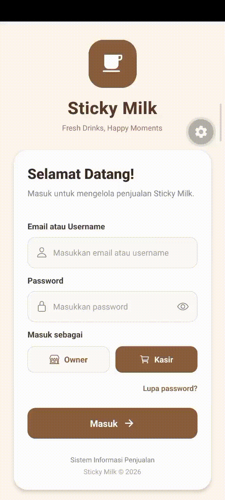

## 2. *Dashboard* - ALFIAH
* *Fungsi utama:* Menampilkan ringkasan aktivitas penjualan.
* *Role terkait:* Admin/Pemilik
### Bukti Video/GIF Pengerjaan Layar

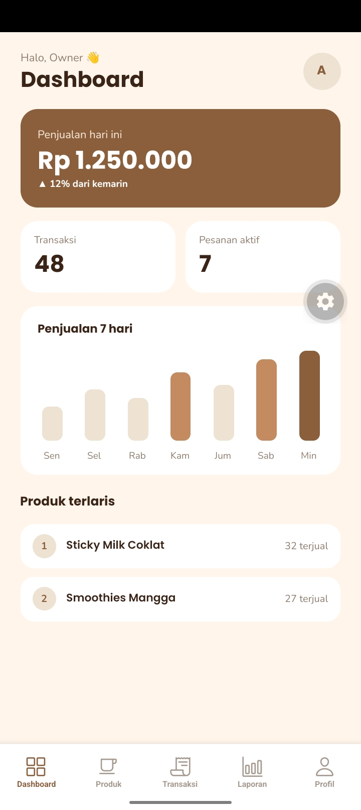

## 3. *Manajemen Produk* - ALFIAH
* *Fungsi utama:* Menampilkan dan mengelola nama produk serta harga.
* *Role terkait:* Admin/Pemilik
### Bukti Video/GIF Pengerjaan Layar

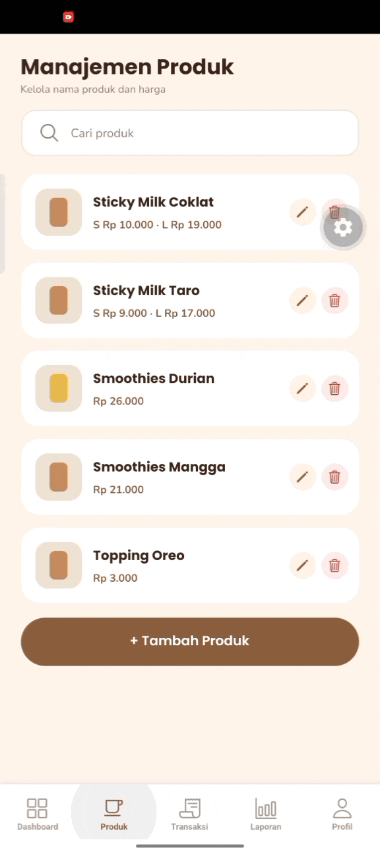

## 4. *Transaksi Penjualan* - DIMAS
* *Fungsi utama:* Memasukkan pesanan, jumlah produk, total, dan pembayaran.
* *Role terkait:* Kasir/Pegawai
### Bukti Video/GIF Pengerjaan Layar

<image src="transaksi-screen-kasir.gif" autoplay="true" ldioop="true" muted="true" width="20%"></image>

## 5. *Antrean Pesanan* - KEVA
* *Fungsi utama:* Menampilkan nomor antrean dan status pesanan.
* *Role terkait:* Kasir/Pegawai
### Bukti Video/GIF Pengerjaan Layar

  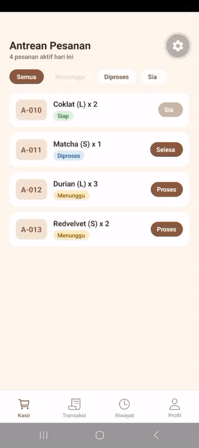

## 6. *Riwayat dan Laporan* - KEVA
* *Fungsi utama:* Menampilkan transaksi terdahulu dan rekap penjualan.
* *Role terkait:* Owner/Pemilik & Kasir
### Bukti Video/GIF Pengerjaan Layar

  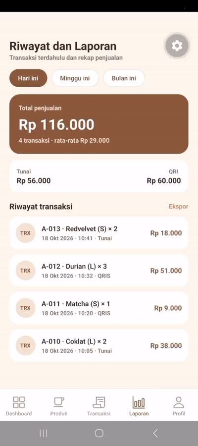
  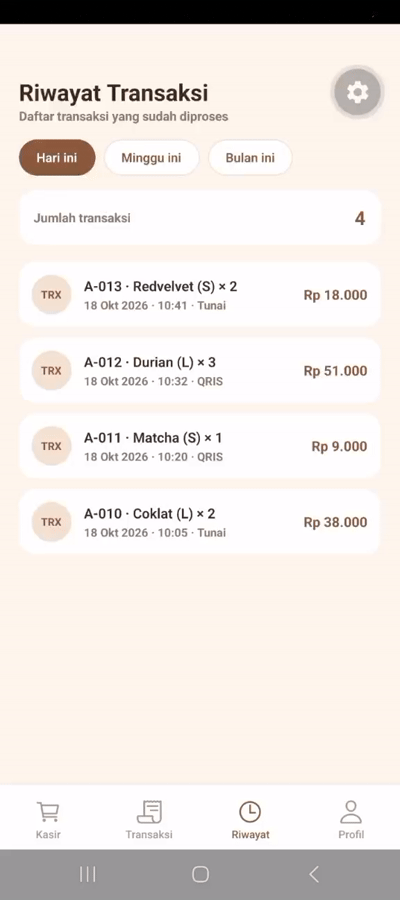

