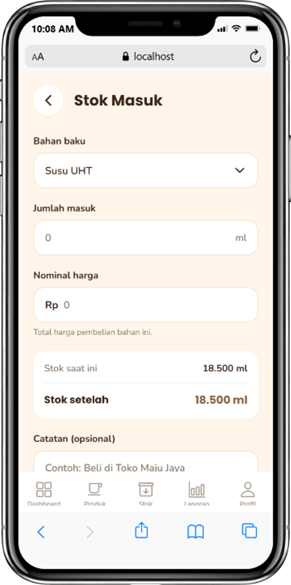
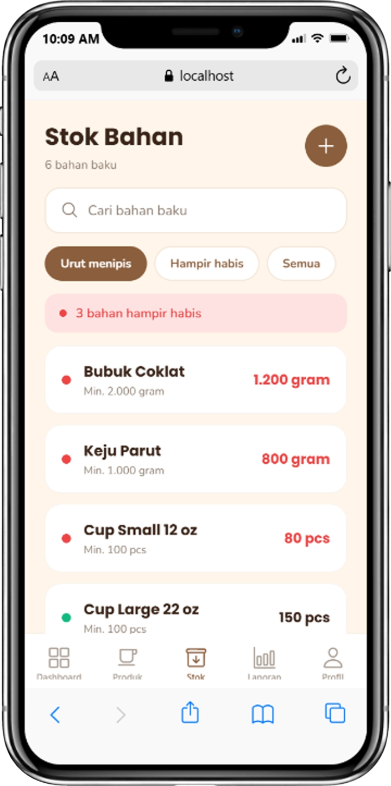

# PERBAIKAN UTS KELOMPOK 6 #
## Sistem Informasi Penjualan dan Pengelolaan Stok pada UMKM Sticky Milk ##
- **Anggota kelompok:**
  1. Dani Hidayat
  2. Dimas Faturohman
  3. Istafty Keva Yuftika
  4. Alfiah Lutfi Sabilah

### 1. Satukan form login dan owner

### 2. Tambahkan Field Nominal harga pada pengadaan stok dan filter stok menipis
#### Bukti Screenshot Field Nominal harga pada pengadaan stok

#### Bukti Screenshot Filter stok

### 3. Pada Laporan buat Saldo, Pendapatan dan Pengeluaran + Filter tanggal, Bulan dan Tahun.

### 4. Menambahkan cetak struk penjualan (Hasil Konfirmasi ke Owner)